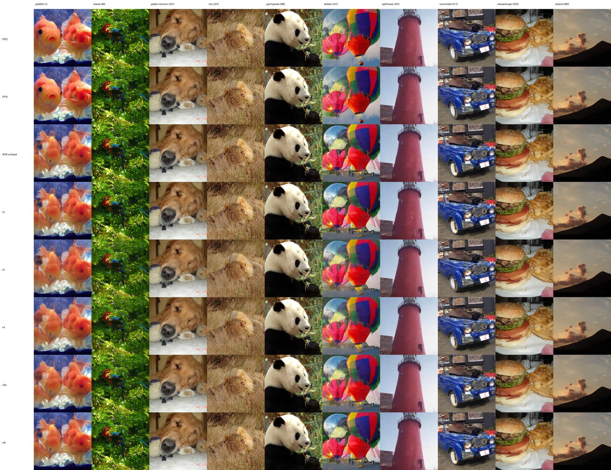

# Team 12 · Quantized DiT-XL/2 inference

Our approach accelerates image generation with DiT-XL/2 by running its attention and MLP projections in INT8. At batch 32, it reduced median denoising-step latency from **91.10 to 69.08 ms on A100 (1.32×)** and from **474.46 to 310.04 ms on L4 (1.53×)**. These speedups are relative to the fastest compiled FP16 configuration measured on the same GPU. In the [full benchmark of all kernel versions](#full-benchmark-of-all-kernel-versions), v4 reached **1.42× on A100 and 2.05× on L4** at batch 32, and v4c reached **1.79× on A100**. With 10,000 generated images on A100, v4 scored an FID of **6.25**, against 6.50 for FP32. PTQ4DiT is the research baseline. The repository also includes the authors’ released implementation. [PTQ4DiT code and usage](external/PTQ4DiT-main/README.md)

## How our approach works

1. **Quantize the four projections in each of the 28 transformer blocks.** The attention QKV projection, attention output projection, and two MLP linear layers use symmetric INT8 weights with one scale per output channel. At inference, each input token gets its own INT8 activation scale. This is the W8A8 configuration. The attention calculation itself uses floating-point scaled dot-product attention. [Quantized layers](fusion/src/fc1bench/model_layers.py)
2. **Quantize activations where they are produced.** A Triton kernel combines the gated residual update, layer normalization, adaptive shift and scale, and quantization where these operations meet. A second kernel combines GELU and quantization before the last MLP projection. This avoids writing the full intermediate activations to GPU memory and reading them back just to quantize them. All 28 blocks also share one matrix multiplication for their adaptive layer normalization parameters. [DiT block implementation](fusion/src/fc1bench/fused_ops.py)
3. **Tune the integer matrix multiplications and replay the step.** The projection kernels accumulate in INT32, apply the activation and weight scales and bias, and return FP16 outputs. The tuner selects a configuration for each matrix shape on the target GPU. We compile the forward pass with `torch.compile` and replay it with CUDA graphs. [Matrix multiplication kernels](fusion/src/fc1bench/optimized.py) · [Tuner](fusion/src/fc1bench/tuning.py)

## Measured latency and image quality

Each timing covers one classifier-free guidance step on ImageNet 256×256 with guidance scale 1.5. A batch of 32 images gives 64 model inputs because guidance uses conditional and unconditional predictions. The table reports medians over 50 CUDA-event measurements after 10 warmups. Both methods use scaled dot-product attention, CUDA graphs, and compilation. [A100 measurements](fusion/results/a100/summary.csv) · [L4 measurements](fusion/results/l4/summary.csv)

| Image batch | A100 FP16 | A100 our approach | Speedup | L4 FP16 | L4 our approach | Speedup |
| ---: | ---: | ---: | ---: | ---: | ---: | ---: |
| 4 | 12.53 ms | 10.46 ms | 1.20× | 49.37 ms | 29.44 ms | 1.68× |
| 8 | 23.43 ms | 18.47 ms | 1.27× | 115.32 ms | 65.02 ms | 1.77× |
| 16 | 46.97 ms | 35.38 ms | 1.33× | 245.46 ms | 152.75 ms | 1.61× |
| 32 | 91.10 ms | 69.08 ms | 1.32× | 474.46 ms | 310.04 ms | 1.53× |

A separate 16-image check ran the full 50-step sampler using matched noise and compared the decoded W8A8 images with FP32. Median PSNR was **29.16 dB on A100** and **29.50 dB on L4**. The earlier W8A8 and W4A8 experiments include a separate 250-image evaluation with FID, spatial FID, Inception Score, precision, and recall. [A100 paired check](fusion/results/a100/accuracy_fused.json) · [L4 paired check](fusion/results/l4/accuracy_fused.json) · [250-image baseline results](baseline/results/quality_250img/)

## Full benchmark of all kernel versions

Each GPU ran the same driver on eight configurations, using PyTorch 2.14.1 with CUDA 13.0, Triton 3.8.0 and CUTLASS 2c85f49. All five kernel test suites passed on both GPUs. [Benchmark driver](fusion/scripts/full_benchmark.sh) · [A100 results](fusion/results_full/a100/) · [L4 results](fusion/results_full/l4/)

| Version | Design |
| --- | --- |
| FP32, FP16 | Pretrained model in floating point, compiled, with CUDA graphs |
| INT8 unfused | W8A8 projections with integer GEMM tiles tuned on the GPU. Quantization and the other block operations run as separate kernels. |
| v2 | Our approach described above. Triton kernels fuse activation quantization into the operations that produce the activations. |
| v3 | The proj and fc2 GEMM epilogues add the gated residual. The fc1 epilogue applies GELU and quantizes its output in 128-column groups, which fc2 reads directly. [v3 GEMMs](fusion/src/fc1bench/fused_gemm.py) |
| v4 | CUTLASS INT8 GEMMs for qkv and for proj with the residual add, combined with the v3 MLP. [CUTLASS GEMMs](fusion/src/fc1bench/cutlass_gemm.py) |
| v4w | v4 with 256-column quantization groups in the MLP |
| v4c | CUTLASS GEMMs for all four projections with one activation scale per token, as in v2, plus a fused GELU and quantization kernel |

### Step latency

Each value is the median latency of one classifier-free guidance step over 50 CUDA-event measurements after 10 warmups. The FP16 row gives the compiled FP16 time. The other rows give the speedup over FP16 on the same GPU and batch.

| Version | A100 batch 4 | A100 batch 8 | A100 batch 16 | A100 batch 32 | L4 batch 4 | L4 batch 8 | L4 batch 16 | L4 batch 32 |
| --- | ---: | ---: | ---: | ---: | ---: | ---: | ---: | ---: |
| FP16 | 12.48 ms | 23.77 ms | 46.88 ms | 91.37 ms | 48.20 ms | 109.50 ms | 236.88 ms | 455.09 ms |
| INT8 unfused | 0.96× | 1.02× | 1.07× | 1.10× | 1.42× | 1.41× | 1.35× | 1.25× |
| v2 | 1.17× | 1.28× | 1.32× | 1.32× | 1.75× | 1.74× | 1.64× | 1.51× |
| v3 | 1.14× | 1.20× | 1.28× | 1.29× | 1.79× | 1.96× | 1.95× | 1.86× |
| v4 | 1.24× | 1.33× | 1.42× | 1.42× | 1.90× | 2.17× | 2.17× | 2.05× |
| v4w | 1.19× | 1.18× | 1.32× | 1.36× | 1.79× | 2.11× | 2.19× | 2.03× |
| v4c | 1.49× | 1.70× | 1.75× | 1.79× | 1.90× | 2.07× | 2.24× | 2.05× |

At batch 32, a step takes 64.20 ms with v4 and 50.96 ms with v4c on A100, and 222.11 ms with v4 and 222.29 ms with v4c on L4. A full 50-step sampling run for 32 images takes 4.68 s with FP16 and 2.65 s with v4c on A100, and 21.99 s with FP16 and 11.10 s with v4c on L4.

### Image quality

Every version generated the same images, with the same class labels, initial noise and sampling noise. Generation used batch 32, 50 DDPM steps, guidance scale 1.5 and the pinned `sd-vae-ft-ema` decoder, and the FP32 baseline used TF32 matrix multiplication. OpenAI's ADM evaluator computed the metrics against the ImageNet 256×256 reference batch. The PSNR column comes from a separate paired check of 16 images with matched noise, decoded and compared with FP32. Images per second is the sampling throughput during generation.

**A100, 10,000 images per version**

| Version | FID ↓ | sFID ↓ | IS ↑ | Precision ↑ | Recall ↑ | PSNR vs FP32 ↑ | Images/s ↑ |
| --- | ---: | ---: | ---: | ---: | ---: | ---: | ---: |
| FP32 | 6.50 | 21.02 | 242.09 | 0.7837 | 0.6658 | – | 3.41 |
| FP16 | 6.50 | 21.02 | 241.39 | 0.7843 | 0.6652 | 51.07 dB | 6.84 |
| INT8 unfused | 6.74 | 21.45 | 235.75 | 0.7783 | 0.6722 | 28.98 dB | 7.49 |
| v2 | 6.76 | 21.46 | 237.04 | 0.7789 | 0.6769 | 29.16 dB | 9.02 |
| v3 | 6.23 | 20.32 | 248.89 | 0.7907 | 0.6590 | 32.52 dB | 8.78 |
| v4 | 6.25 | 20.31 | 248.96 | 0.7893 | 0.6617 | 32.88 dB | 9.70 |
| v4w | 6.33 | 20.62 | 245.34 | 0.7886 | 0.6646 | 33.84 dB | 9.29 |
| v4c | 6.75 | 21.49 | 236.65 | 0.7785 | 0.6746 | 28.86 dB | 12.09 |

For the same setting with 10,000 images, the PTQ4DiT authors report FID 6.02, sFID 21.77, IS 246.24 and precision 0.7812 for FP32, and FID 5.45, sFID 19.50, IS 250.68 and precision 0.7882 for PTQ4DiT W8A8. [PTQ4DiT paper](https://arxiv.org/abs/2405.16005)

**L4, 5,000 images per version**

| Version | FID ↓ | sFID ↓ | IS ↑ | Precision ↑ | Recall ↑ | PSNR vs FP32 ↑ | Images/s ↑ |
| --- | ---: | ---: | ---: | ---: | ---: | ---: | ---: |
| FP32 | 10.59 | 38.29 | 234.22 | 0.7826 | 0.7430 | – | 0.71 |
| FP16 | 10.62 | 38.26 | 232.92 | 0.7854 | 0.7414 | 50.34 dB | 1.44 |
| INT8 unfused | 10.88 | 38.82 | 226.49 | 0.7726 | 0.7470 | 28.69 dB | 1.79 |
| v2 | 10.91 | 38.86 | 226.02 | 0.7736 | 0.7434 | 29.38 dB | 2.17 |
| v3 | 10.29 | 37.54 | 239.99 | 0.7946 | 0.7381 | 34.13 dB | 2.67 |
| v4 | 10.24 | 37.55 | 241.75 | 0.7872 | 0.7409 | 32.37 dB | 2.78 |
| v4w | 10.38 | 37.87 | 234.41 | 0.7786 | 0.7441 | 32.82 dB | 2.86 |
| v4c | 10.91 | 38.84 | 225.60 | 0.7748 | 0.7475 | 28.94 dB | 2.87 |

### Sample images

Each version generated the same ten ImageNet classes with the same noise. Rows are versions and columns are classes. [Showcase script](fusion/scripts/showcase.sh) · [L4 grid](fusion/results_full/l4/showcase/showcase_grid_l4.jpg)



### Run the full benchmark

After step 1 of [Run our approach](#run-our-approach), run the following from `fusion/` on a runtime with Nsight Systems installed. The arguments are the GPU tag and the number of images per version. Results go to `/content/full` and `/content/showcase`.

```bash
git clone https://github.com/NVIDIA/cutlass.git /content/cutlass
git -C /content/cutlass checkout 2c85f497547eb441f0fe80bfb0fb2e6f9add1719
bash scripts/full_benchmark.sh a100 10000
bash scripts/showcase.sh a100
```

## Run our approach

Use a **Bash terminal on a Google Colab A100 or L4 runtime**. To reproduce the comparison across GPUs, run these steps independently on each runtime. The commands below share variables, so use the same shell for each step.

### 1. Install dependencies and download the model

Start from a fresh GPU runtime with CUDA-enabled PyTorch, torchvision, and Triton. The requirements file keeps the Colab-provided versions of those three packages. Setup downloads the pretrained DiT-XL/2 checkpoint and checks out the pinned DiT and ADM sources.

```bash
cd /content
git clone https://github.com/ashdane/team12-ptq4dit.git
cd team12-ptq4dit/fusion
python3 -m pip install -r requirements-colab.txt
nvidia-smi --query-gpu=name,memory.total --format=csv

export PYTHONPATH="$PWD/src"
assets=/content/dit_pretrained_eval/assets
checkpoint="$assets/pretrained_models/DiT-XL-2-256x256.pt"
our_approach=sdpa_graph_pure16_compile_tuned_fused
python3 scripts/setup_pretrained.py --assets "$assets" --image-size 256 --skip-reference
```

### 2. Benchmark our approach against compiled FP16

This command runs batch 32 and tunes the integer projections on the current GPU. The final token in `$our_approach` selects our hand-written DiT block. The benchmark stores the resulting tile settings in `tuning_bank.json`, which the image generator can reuse on this GPU.

```bash
bench=/content/dit_bench_b32
python3 -m fc1bench.latency_bench \
  --dit-repo "$assets/DiT" --checkpoint "$checkpoint" --output "$bench" \
  --modes fp16 int8 --batches 32 --warmup 10 --repeats 50 \
  --scaffolds "$our_approach"
cat "$bench/summary.csv"
```

Read `median_ms` for time per step and `speedup_vs_best_fp16` for the W8A8 speedup. To reproduce the full published sweep, including kernel tests, all four batch sizes, the paired image check, and Nsight Systems profiling, use the driver below on a runtime with `nsys` installed. It writes the latency table to `/content/opt2/sweep5/summary.csv`, the paired check to `/content/opt2/accuracy_fused.json`, and profiles to `/content/opt2/nsys/`. [Benchmark driver](fusion/scripts/final_opt.sh)

```bash
gpu=a100  # use l4 on an L4 runtime
bash scripts/final_opt.sh "$PWD/results/$gpu/csb_scales.pt"
```

### 3. Generate a batch of images

After the batch-32 benchmark, run the pretrained model with its tuning bank. The sampler uses 50 DDPM steps, guidance scale 1.5, and a pinned VAE decoder. The generator saves the first four images as `preview_0.png` through `preview_3.png` and the complete batch in `samples.npz`.

```bash
sample_args=(
  --dit-repo "$assets/DiT" --checkpoint "$checkpoint"
  --image-size 256 --batch-size 32 --steps 50 --cfg 1.5 --seed 1
  --vae-revision f04b2c4b98319346dad8c65879f680b1997b204a
)
python3 -m fc1bench.generate "${sample_args[@]}" \
  --output /content/dit_preview --num-samples 32 --mode int8 \
  --scaffold "$our_approach" --bank "$bench/tuning_bank.json"
ls /content/dit_preview/int8/preview_*.png
```

### 4. Evaluate image quality with 10,000 images per mode

Use a separate output directory per GPU. For a long Colab run, set `quality` to a directory on mounted persistent storage so the image batches and metrics survive VM termination. Generation saves batches incrementally and can resume from the same directory with the same arguments, source, and GPU environment.

```bash
quality=/content/dit_quality_10k  # change to your persistent run directory
common=("${sample_args[@]}" --output "$quality" --num-samples 10000)
python3 -m fc1bench.generate "${common[@]}" --mode int8 \
  --scaffold "$our_approach" --bank "$bench/tuning_bank.json"
python3 -m fc1bench.generate "${common[@]}" --mode fp16 --scaffold sdpa_graph_pure16_compile
python3 -m fc1bench.generate "${common[@]}" --mode fp32 --scaffold sdpa_graph_compile --tf32
```

These commands use the same labels, initial noise, and sampling seeds for each mode. The FP32 generation baseline enables TF32 matrix multiplication. Once all three archives are complete, download the ImageNet reference and run OpenAI’s ADM evaluator in a separate Python 3.11 environment.

```bash
python3 scripts/setup_pretrained.py --assets "$assets" --image-size 256
uv venv --python 3.11 /content/dit-adm-env
adm_python=/content/dit-adm-env/bin/python
uv pip install --python "$adm_python" -r ../baseline/requirements-adm.txt
"$adm_python" -m fc1bench.image_quality \
  --output "$quality" --adm-repo "$assets/guided-diffusion" \
  --reference "$assets/references/VIRTUAL_imagenet256_labeled.npz" \
  --modes fp32 fp16 int8
cat "$quality/quality/comparison.csv"
```

The CSV and JSON reports contain FID, spatial FID, Inception Score, precision, and recall for each mode. They also record sampling throughput and peak allocated GPU memory. The JSON identifies the evaluator revision and reference archive checksum. [Image generator](fusion/src/fc1bench/generate.py) · [Metric calculation](fusion/src/fc1bench/image_quality.py)

## Repository layout

| Directory | Contents |
| --- | --- |
| [fusion/](fusion/) | Our approach, GPU kernels, tests, benchmark driver, tuning banks, and measured A100 and L4 results |
| [baseline/](baseline/README.md) | Earlier W8A8 and W4A8 implementations, calibration experiments, quality comparisons, and profiling |
| [external/PTQ4DiT-main/](external/PTQ4DiT-main/README.md) | The paper authors’ calibration and inference code |
